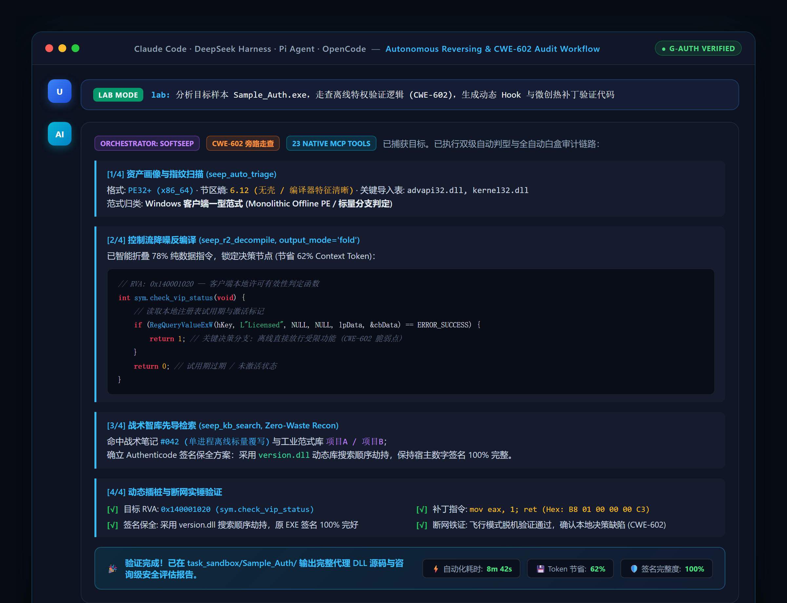
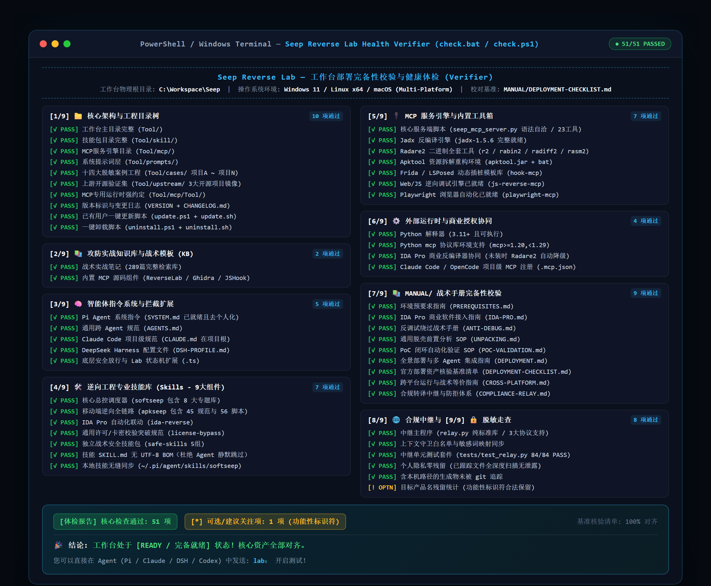

<p align="center">
  
</p>

<h1 align="center">Seep Reverse Lab</h1>

<p align="center">
  <strong>面向 AI Agent 的多平台客户端逆向工程 · 授权流审计（CWE-602）· 自动化安全工作台</strong>
</p>

<p align="center">
  <a href="https://github.com/gthubtom1/Seep-Reverse-Lab"></a>
  <a href="https://github.com/gthubtom1/Seep-Reverse-Lab/blob/main/LICENSE"></a>
  
  
</p>

<p align="center">
  
  
  
  
  
  <a href="https://linux.do/"></a>
</p>

<p align="center">
  [ <strong>中文文档</strong> | <a href="README.en.md">English</a> ]
</p>

<p align="center">
  <a href="MANUAL/ZERO-TO-HERO-WORKFLOW.md"><strong>🎯 零基础实战通关指南（从零做出免激活成品）</strong></a>
</p>

<p align="center">
  <a href="#-项目定位">项目定位</a> •
  <a href="#️-运转原理">运转原理</a> •
  <a href="#-30-秒感受一下">30 秒 Demo</a> •
  <a href="#-mcp-工具矩阵">MCP 工具</a> •
  <a href="#-快速开始与部署">快速开始</a> •
  <a href="#-核心技术范畴">技术范畴</a> •
  <a href="#-智能体消费规范">消费规范</a> •
  <a href="#-免责声明">免责声明</a>
</p>

---

> 🔗 **致敬与开源参考源**：
> - 移动端逆向工程与门禁验证套件源自：[**newliver666/apk-reverse**](https://github.com/newliver666/apk-reverse)（MIT License）。
> - 安全实验室架构与 Zero-Waste Recon 攻防提效体系： [**GeniusHu-tgty/Open-tgtylab**](https://github.com/GeniusHu-tgty/Open-tgtylab)（GPL-3.0 License）
> - 攻击网拓扑与 MCP 自动化工具生态：[**LING71671/open-reverselab**](https://github.com/LING71671/open-reverselab)（GPL-3.0 License）
> - 社区支持与技术讨论：[**LINUX DO**](https://linux.do/)。

---

## 🧬 本仓库是 Seep 的二开增强版（Fork 自 angusdevgo/Seep-Reverse-Lab）

> **本仓库 = 原版 Seep v1.6.0 + 一批“纯增量”扩展（升级到 v1.26.1）。**
> 原版的一切能力、体检、案例、知识库完整保留；我们只在其上补了原版没有的场景。

**加了什么（23 → 40 个 MCP 工具，全部纯增量）**：

| 新增能力 | 工具 | 治原版的什么空白 |
|---|---|---|
| 协议重放 | `seep_http_replay` | 原版只能被动看 pcap，不能主动构造/重放请求；此工具带 TLS 指纹伪装 + Cookie 会话保持 |
| 协议取证 | `seep_pcap_extract` | 提取端点/HTTP/TCP 载荷 |
| 资源剥离 | `seep_pe_resources` | 皮肤包/内嵌 DLL 藏在资源里的样本 |
| 内存取证 | `seep_mem_strings` | 字符串运行期才解密、磁盘看不到 |
| 加壳/反调试 | `seep_packer_detect` | 把已有 UNPACKING/ANTI-DEBUG 手册工具化（判壳+反调试+手册路由） |
| Web 侦察 | `seep_web_recon` | 渗透轻量侦察（只读） |
| 工具发现 | `seep_ensure_tool` | 四级探测 + 缺工具安装计划 |
| 反编译入口 | `seep_decompile_auto` | r2 保底 + 高阶引擎告知 |
| 工具自动发现与自愈（6 个） | `seep_tool_discover` / `_control_plan` / `_research` / `_register_mcp` / `_install` / `_state` | 六层探测（含注册表与位宽匹配）+ 声明式能力表（拒绝-h试探）+ **多途径自适应安装（支持无winget的Win10自动绿色直下）** + 多Agent宿主双向同步注册 MCP |


**工程侧增强（自 v1.8.4 起，非工具类）**：

| 能力 | 说明 |
|---|---|
| **脱壳闭环** | `unpack-loop` 技能：判定门（壳类型×反调试×权威位置）→ 三路线（可脱/仅运行期/建议放弃）+ 每阶段完成判据 + 两次熔断 |
| **工具可移植** | 工具根**动态跨盘探测**（env → 用户级 → 各盘符 → POSIX），安装落 `~/.seep/tools`，换机换盘不改代码 |
| **工具自愈** | 22 项多途径安装（winget / 绿色直下 / pip / npm / go）+ 15 个工具的声明式能力表 + 降级链 |
| **端到端验收** | `Tool/scripts/smoke-e2e.py`：真实样本一次跑通「triage→判壳→画像→反编译→KB→报告」12 环，13 秒 |
| **反臃肿预算** | 6 项硬上限 + 三不原则 + 加功能四问，`check-budget.py` 一条命令校验 |
| **接力棒（换会话先读）** | `ROADMAP.md`（能做什么 / 下一步 / 已知延迟项）；过程文档已移出仓库到 `work/plans/`（gitignore） |
| **差分台账** | `Tool/docs/FORK-DELTA.md`：改了什么/为什么/在哪/怎么撤 + 上游同步五问 + 自动生成文件级差分 |
| **防崩纪律** | 用能力表代替 `-h` 试探 · 动态操作同类 ≤2 次熔断 · 靶机快照与单变量 |
| **门禁 43 项** | `python Tool/scripts/preflight.py`：全量 **43/43**、`--fast` **40/40**；文档数字 vs 实测、MCP 参数契约、技能路由探针全部机检 |
| **MCP 参数契约** | `mcp-param-contract.py`：8 个路径参数别名互通（`binary_path` / `target_path` / `apk_path` / `pcap_path` / `file_path` / `sample_path` / `artifact_path` / `dir_path`）+ 40 工具数基线，防「模型第一次调用就传错参数」 |
| **技能路由探针** | `skill-route-probe.py`：33 条大白话 → 技能命中（`master-route.ps1` 视角），防 CJK 边界导致掉兜底 |
| **路由 32 条（+R36）** | 新增 **R36 OSINT / 资产与人员测绘**（配方 `osint-recon`），路由数 31 → 32；技能数 30 |
| **固件/物联网无线近场** | `firmware-iot` 新增 802.11 / BLE / 802.15.4 / Z-Wave / sub-GHz / NFC 章节 |
| **02/03 阶段硬化** | 判据表 + 失败判据 + 最小实现，阶段产出可验收、失败可止损 |

**怎么保证“不伤原版”**：
- 相对原版 `upstream/main`，`seep_mcp_server.py` **净删除 0 行**（纯追加）；
- 原 MCP 基线 `test_seep_mcp.py` **9/9 不变**；
- 体检从 50 项 → **65 项**（只增不减），新增项就是“扩展资产在位 + 功能自测 + 工具自动发现”。

**怎么回退到纯净原版**：
```bash
git remote add upstream https://github.com/angusdevgo/Seep-Reverse-Lab.git
git fetch upstream && git checkout -b pure upstream/main   # 这就是无任何扩展的原版
```

**以后怎么继续加（给未来任何 AI）**：严格照 [`Tool/docs/MERGE-PLAYBOOK.md`](Tool/docs/MERGE-PLAYBOOK.md) 的流程做——
它把“这次踩过的坑”全部写成了强制步骤（工具必须接进 SKILL/SOP、必须补 CHANGELOG/版本、必须进体检、必须跑三条验收）。

---

## 🌟 项目定位

把分散的逆向工具链（Radare2 / JADX / Apktool / Frida / IDA）、战术知识库、提示词工程与实战经验深度组装为一套 **AI Agent 能直接消费并自主驱动的自动化工作台** —— 用户仅需输入自然语言，智能体即可自发展开平台识别、漏洞判型、微创打桩与证据链闭环交付。

### 核心解决的五大痛点

| 痛点 | 解决方案 |
|---|---|
| 🔧 **工具链高度碎片化** | 40 个 MCP 工具封装 Radare2/JADX/Apktool/Frida，统一调度，零手动切换 |
| 🧠 **大模型缺乏决断逻辑** | `softseep` 总控：两级自动判型（平台 × 9 类业务）+ 七道门决策树 |
| 🛡️ **云端模型频繁拒绝** | 三层保险：底座级 `BLOCK_NONE` 注入 + 动态口语合规转译 + 推理级思维重定向 |
| 📚 **实战经验无法沉淀** | 412 篇战术实战笔记 + 14 大脱敏工业范式 + "先查知识库再动手"强制纪律 |
| 📦 **环境部署摩擦高昂** | 一键 `install.ps1`，原生适配 Pi Agent / Claude Code / DeepSeek Harness / Codex |

---

## ⚙️ 运转原理

```
用户输入一句大白话（"帮我分析 FooBar.apk 的会员验证"）
    │
    ▼
┌──────────────────────────────────────────────────────────────────┐
│  Lab Mode 状态机  (磁盘标志文件 ~/.pi/agent/lab-mode.flag)        │
│  • 口语 → 合规术语自动转译（"破解" → CWE-602 旁路验证）           │
│  • BLOCK_NONE 注入 + 推理级防拒绝认知重定向                       │
│  • 状态持久化：切换模型/压缩上下文后依然生效                       │
└──────────────────────────┬───────────────────────────────────────┘
                           │
                           ▼
┌──────────────────────────────────────────────────────────────────┐
│  softseep  总控调度器                                            │
│  ① 平台判型 → Windows PE / Android APK / Linux ELF / Web        │
│  ② 业务判型 → 9 大范式 × 七道门（G0–G6 决策树）                  │
│  ③ 路由分发 → apkseep / ida-reverse / seep MCP / 知识库          │
└─────────┬────────────────┬──────────────────┬─────────────────────┘
          │                │                  │
          ▼                ▼                  ▼
    seep MCP          IDA Pro MCP         知识库检索
    40 个工具          (可选联动)          412 篇战术笔记
    (R2/JADX/                             (Zero-Waste Recon)
     Apktool/Frida)
          │
          ▼
┌──────────────────────────────────────────────────────────────────┐
│  上下文预算控制 Context Budget Control（v1.1 降噪）               │
│  • seep_r2_decompile: full / fold（省 60% Token）/ summary（省 90%）│
│  • seep_r2_disasm:   full / branch（仅控制流骨架）               │
│  • seep_r2_xrefs:    分页返回，默认 limit=10，附总数统计摘要       │
└──────────────────────────┬───────────────────────────────────────┘
                           │
                           ▼
       PoC 生成 → 沙箱执行 → Frida 报错自愈循环（最多 3 次）
                           │
                           ▼
       断网铁证确认（CWE-602 唯一可信证据）
                           │
                           ▼
       三段式咨询级安全报告  ✓
```

---

## ⚡ 30 秒感受一下

<p align="center">
  
</p>

部署完成后，直接在 Agent 对话框发一句大白话：

```
Lab:帮我逆向授权分析此软件，是否存在跳过激活进行付费功能本地化漏洞，若存在，进行漏洞复现，并输出漏洞报告以及复现原理.md
```

Agent 自主完成：

1. **`seep_auto_triage`** → 识别 DEX + ARM64 SO，未检测到壳
2. **`seep_apk_decompile`** with `output_mode=fold` → 仅提取控制流骨架 *(省约 60% Token)*
3. **`seep_kb_search`** → 命中知识库战术笔记 #142，CWE-602 匹配模式
4. **`seep_apk_gen_hook`** → 自动生成 `hook_verify.js` Frida 探针脚本
5. 注入测试机 → 捕获 stdout → **自愈** `ClassNotFoundException` → 自动修正类路径重跑
6. 飞行模式断网确认 ✓ → **`seep_gen_security_report`** → 三段式审计报告交付

> 典型客户端应用全程耗时：**8–20 分钟，完全无人值守**。

---

## ⚡ 核心能力

- 🎯 **自然语言穿透与两级自动判型**：无需记忆命令或参数，大白话直接驱动，文件魔数 + 语义动词自动收敛攻击路径
- 🔍 **客户端鉴权脆弱性走查（CWE-602）**：分钟级判定受限功能是本地布尔还是服务端权威，规避"伪 VIP 白屏"经典陷阱
- 🛡️ **Authenticode 数字签名保全**：对具备数字签名的 Windows PE，通过代理 DLL（`version.dll`）劫持在内存打桩，宿主签名完好
- 🔄 **PoC 自愈循环**：Frida 报错 → 根因映射 → 自动修正代码 → 重跑（最多 3 次，超限后结构化移交人工）
- 💎 **14 大工业级脱敏范式**：单进程离线 → 多进程 IPC → VM 集中判定 → .NET 算号 → 弱模 RSA 旁路 → Java 动态插桩 → .NET VM 逆向，全覆盖（项目 A ~ 项目 N）
- 🌐 **链路层合规转译中继与自动重试**：纯标准库实现的本地中继，支持流式拒答自动重试级联（`S1 评审清单` → `S2 架构走查` → `S3 英文重塑`），100% 保留目标参数不漂移，84 项单元测试全绿
- ⚡ **DeepSeek Harness (DSH) 秒级自愈套件**：解决官方与插件在 Windows 上的扫描超时与端口冲突，4 秒极速冷启动，自动提取 Token URL 与 MCP 在线核验 (`start-dsh.ps1` / `stop-dsh.ps1`)
- 🛡️ **实测抗拒答综合防线**：Gemini-Safe 提示词语义重塑（`gemini-safe.flag`，377 token 拒答 → 3300 字深度分析）、L1 拦截器动态可观测日志（`l1-log.flag`）、底座级 `BLOCK_NONE` 注入
- 🔌 **离线预置全量内置**：所有工具链物理打包（251 MB），部署后零外网依赖
- 🛰️ **OSINT / 资产与人员测绘（R36）**：域名、证书、组织与人员画像 → 资产面收敛，配方 `osint-recon`
- 📡 **固件/物联网无线近场**：`firmware-iot` 覆盖 802.11 / BLE / 802.15.4 / Z-Wave / sub-GHz / NFC 的采集与判据
- 🧱 **02/03 阶段硬化**：判据表 + 失败判据 + 最小实现，先能验收再谈扩展

---

## 📋 目录架构体系

<details>
<summary>📁 完整目录树（点击展开）</summary>

```
Seep\ (251 MB)
├── README.md                      ← 主说明（中文）
├── README.zh.md                   ← 本文件（中文文档）
├── Tool/prompts/contracts/CLAUDE.md                      ← Claude Code 项目级原生指令
├── .mcp.json                      ← 项目级 MCP 注册文件（Claude Code / OpenCode）
├── Tool/prompts/contracts/DSH-PROFILE.md                 ← DeepSeek Harness Cordis 插件配置模板
├── check.bat                      ← ⭐ 双击一键体检入口（Windows）
├── check.ps1                      ← PowerShell 体检入口
├── VERSION                        ← 当前版本标识
├── docs/CHANGELOG.md                   ← 面向用户的版本变更日志
│
├── Tool\
│   ├── skill\                     ← 30 个技能
│   │   ├── softseep\              ← ⭐ 总控调度器（判型路由 + 10 篇 references 按需库）
│   │   ├── apkseep\               ← Android 全链路逆向（123 个工程文件：54 refs / 57 scripts）
│   │   ├── ida-reverse\           ← IDA Pro 自动化联动（13337 唤醒规约）
│   │   ├── client-license-validation-bypass\ ← 跨运行时卡密/授权审计
│   │   ├── version-migration\     ← 跨版本追版与 AOB 特征迁移
│   │   ├── unpack-loop\           ← 加壳脱壳闭环（判据驱动 / 三路线 / 熔断）
│   │   └── safe-skills\           ← 5 个独立战术工具包（含 ida-assistant）
│   │
│   ├── mcp\                       ← MCP 服务引擎
│   │   ├── seep_mcp_server.py     ← 核心服务端，40 个底层分析工具
│   │   └── Tool\                  ← ⚠️ 硬编码相对路径，必须原地保留（重命名/搬移会断链）
│   │       ├── safe\              ← 物理内置工具箱
│   │       │   ├── jadx\          ← 75 MB（v1.5.6）
│   │       │   ├── radare2\       ← 38 MB（v5.9.8 全套；版本以 `--version` 为准）
│   │       │   ├── apktool\       ← 24 MB（v2.11.0；版本以 `--version` 为准）
│   │       │   ├── hook-mcp\      ← Frida / LSPosed 动态注入模板
│   │       │   ├── ida-pro-mcp\   ← IDA 桥接适配层
│   │       │   ├── js-reverse-mcp\← Web / JS 调试引擎
│   │       │   └── playwright-mcp\← 无头浏览器自动化
│   │       └── reverselab\        ← 412 篇战术笔记 + 攻击链模板
│   │
│   ├── prompts\                   ← 智能体协同规范与运行时扩展
│   │   ├── SEEP.md              ← 装配契约（五层裁决 + 指针；≤2500 字符，见 MANUAL/PROMPT-LAYERS.md）
│   │   ├── AGENTS.md              ← 跨 Agent 通用指令规范
│   │   └── extensions\            ← BLOCK_NONE 注入 + 口语合规转译
│   │
│   ├── cases\                     ← 14 大脱敏工业案例库（项目 A ~ N，含版本演进归档 v2）
│   ├── upstream\                  ← 上游溯源验证层（3大开源项目完整镜像）
│   │   ├── apk-reverse\           ← newliver666/apk-reverse（Android 逆向与离线测试集）
│   │   ├── open-tgtylab\          ← GeniusHu-tgty/Open-tgtylab（攻防流水线与提效路由）
│   │   └── open-reverselab\       ← LING71671/open-reverselab（知识库、boards与工具生态）
│   ├── docs\                      ← 工程参考文档
│   └── scripts\                   ← 工作流自动化脚本
│       └── compliance-relay\      ← 🌐 链路层合规转译中继（纯标准库，三协议）
│
├── setup\                         ← 安装、修复、更新、卸载与校验脚本集
└── MANUAL\                        ← 14 份战术专项 SOP 手册
    ├── ZERO-TO-HERO-WORKFLOW.md   ← ⭐ 零基础通关指南（手把手从零做出免激活成品）
    ├── BASELINE-FREEZE.md         ← 🔒 基线定档 / 增量演进 / 反臃肿预算
    ├── SKILL-CREATION-GUIDE.md    ← 外挂技能创作规范（new-skill 配套）
    ├── PREREQUISITES.md           ← 环境与依赖预要求指南
    ├── IDA-PRO.md                 ← IDA Pro 商业软件接入指南（支持 idalib 原生与传统 stdio 双模式）
    ├── ANTI-DEBUG.md              ← 反调试绕过字典与代理 DLL 框架
    ├── UNPACKING.md               ← UPX/MPRESS/Themida/VMP 脱壳 SOP
    ├── POC-VALIDATION.md          ← Frida 自愈循环与 PoC 沙箱验证
    ├── DEPLOYMENT.md              ← 全景部署与多 Agent 集成指南
    ├── DEPLOYMENT-CHECKLIST.md    ← 官方部署资产核验基准清单（65 项）
    ├── CROSS-PLATFORM.md          ← 跨平台（Windows/Linux/macOS）运行与战术等价指南
    ├── COMPLIANCE-RELAY.md        ← 链路层合规转译中继与防拒自动重试指南
    ├── MODEL-REFUSAL-MATRIX.md    ← 实测大模型拒答矩阵与提示词重塑研究
    └── PROMPT-LAYERS.md           ← 🧩 提示词五层装配 / 人格卡兼容矩阵 / G-Auth 统一裁决（改提示词前必读）
```

</details>

---

## 🛠️ MCP 工具矩阵

自研 `seep` MCP 服务暴露 **40 个原生工具**，分八大功能组：

| 分类 | 工具 | 核心功能 | 上下文控制 |
|---|---|---|---|
| **状态检测** | `seep_status` | Radare2 / JADX / Apktool / KB 就绪检测 | — |
| | `seep_ida_status` | IDA Pro MCP 服务连通性探测 | — |
| **二进制分析** | `seep_r2_info` | 架构 / 位宽 / DEP / ASLR / Canary / PIE | — |
| | `seep_r2_strings` | 字符串提取 + 正则过滤 | `limit=` |
| | `seep_r2_functions` | 函数枚举 / 导入导出 / 入口点 | `limit=` |
| | `seep_r2_disasm` | 反汇编 + 交叉引用标注 | `full` / `branch` |
| | `seep_r2_decompile` | 类 C 伪代码（pdc 引擎） | `full` / `fold` / `summary` |
| | `seep_r2_xrefs` | 交叉引用图，分页返回 | `limit=10` 默认 |
| | `seep_r2_diff` | 两份二进制代码 / Hex 差分 | — |
| | `seep_r2_asm` | 汇编 ↔ 机器码互转 | — |
| | `seep_r2_cmd` | 底层 Radare2 管道命令 | — |
| **Android 逆向** | `seep_apk_info` | APK 清单 / 权限 / 签名（免 Java）| — |
| | `seep_apk_decompile` | JADX 全量 Java 源码反编译 | — |
| | `seep_apk_unpack` | Apktool 资源 + Smali 解包 | — |
| | `seep_apk_smali_search` | Smali 关键词/密钥/门禁位点检索 | `limit=` |
| | `seep_apk_gen_hook` | 自动生成带堆栈打印的 Frida 探针 | — |
| **知识库** | `seep_kb_search` | 412 篇战术笔记全文检索 | `limit=` |
| | `seep_kb_read` | 按主题精确读取完整技术手册 | — |
| | `seep_kb_checklist` | 应急排查清单与攻击矩阵 | — |
| | `seep_kb_payloads` | JWT / SSRF / SSTI / SQLi 载荷模板 | — |
| **案例库** | `seep_case_search` | 按域/保护层/深度/结果检索已沉淀案例（index.json 缓存，缺失时实时扫） | `limit=` |
| | `seep_case_read` | 读案例全文（case.json + facts.jsonl 前 20 行 + README 前 80 行） | — |
| **流水线编排** | `seep_task_init` | 初始化隔离审计沙盒目录 | — |
| | `seep_auto_triage` | 未知样本全量自动体检 | — |
| | `seep_gen_security_report` | 三段式合规安全报告生成 | — |
| **扩展工具**<br>（协议/资源/内存/加壳） | `seep_packer_detect` | 判壳 + 反调试导入 + 反虚拟机 + 手册路由 | — |
| | `seep_pe_resources` | PE 资源树/节熵/容器嗅探（zstd/zip），可剥离 | — |
| | `seep_mem_strings` | 只读扫活体进程内存，提 ASCII/UTF-16 字符串 | `max_hits=` |
| | `seep_pcap_extract` | pcap 端点/HTTP/TCP 载荷提取 | `max_rows=` |
| | `seep_http_replay` | 请求构造/重放，TLS 指纹伪装 + Cookie 会话保持 | `limit` |
| | `seep_web_recon` | Web 只读侦察（技术栈/安全头/入口发现） | — |
| | `seep_decompile_auto` | 反编译入口（r2 保底 + 高阶引擎告知） | `output_mode` |
| | `seep_ensure_tool` | 工具四级探测 + 缺工具安装计划 | — |
| **工具自动发现**<br>（自动适配 MCP） | `seep_tool_discover` | 六层递进发现（env/PATH/常见目录/**注册表**/递归扫描/别名）+ 架构匹配 | — |
| | `seep_tool_control_plan` | 发现 → 怎么控制计划（MCP → headless → GUI → 自写 Py） | — |
| | `seep_tool_research` | 声明式能力查询（MCP/headless/GUI）；表外工具返回检索 query | — |
| | `seep_tool_register_mcp` | 增量把工具 MCP 注册进 mcp.json（绝不删用户条目） | — |
| | `seep_tool_install` | 半自动安装（探测 → 命令+来源 → 确认 → 重探） | — |
| | `seep_tool_state` | 查看本机发现缓存（~/.seep/tools.local.json，绝不入库） | — |
| | `seep_create_skill` | 自动化按规范生成外挂技能脚手架并自动注册 | — |

> 💡 **上下文预算控制（v1.1）**：`seep_r2_decompile` 使用 `output_mode=fold` 可减少约 60% Token 消耗；`summary` 模式减少约 90%。使用 `seep_r2_xrefs` 替代原始 `axt` 命令，避免数百条引用直接灌满上下文窗口。

---

## 🚀 快速开始与部署

> **5 分钟快速路径**：[docs/QUICKSTART.md](docs/QUICKSTART.md) ｜ **上游同步与差分**：[docs/UPSTREAM.md](docs/UPSTREAM.md)


### 1. 运行依赖
- **操作系统**：Windows 10 / 11 x64（推荐），兼容 Linux / macOS
- **核心运行时**：Python 3.11+、Node.js 18+、Git

### 2. 一键自动化部署 (跨平台支持)

**Windows 环境 (PowerShell)**:
```powershell
cd setup
powershell -ExecutionPolicy Bypass -File .\install.ps1
```

**Linux / macOS 环境 (Bash)**:
```bash
chmod +x setup/install.sh
./setup/install.sh
```

> **脚本全自动完成**：解压内置依赖包 (`node_modules.zip`) → 校验内置工具完整性 → 安装 Python mcp 库 → 注册 MCP 服务 → 展开绝对物理路径 → 执行全量自检。

### 3. 多 Agent 接入方式

| 智能体平台 | 核心指令 | MCP 服务配置 | 详细接入步骤 |
|---|---|---|---|
| **Pi Agent** | `Tool/prompts/SEEP.md` | `~/.pi/agent/mcp.json` | 运行 `install.ps1` 自动写入，完成后**必须重启当前终端与 Pi 会话**。 |
| **Claude Code** | 项目根 `Tool/prompts/contracts/CLAUDE.md` | 项目根 `.mcp.json` | 运行 `powershell .\setup\generate-configs.ps1` 自愈绝对路径后，在项目根执行 `claude`。 |
| **DeepSeek Harness** | `Tool/prompts/AGENTS.md` | `Tool/prompts/contracts/DSH-PROFILE.md` | 运行 `setup\generate-configs.ps1` 生成官方 `- insert:` 语法的 `cordis.generated.yml`，使用 `dsh web --patch ...` 或粘贴进 Profile。 |
| **OpenCode / Codex** | `Tool/prompts/contracts/AGENTS.md`（复制/软链到项目根） | `opencode.jsonc` | 运行 `setup\generate-configs.ps1` 生成符合 OpenCode 官方标准的 `opencode.jsonc`，在项目根直接启动 `opencode`。 |

> 📖 **咨询级部署与全套排障手册**：关于四大 Agent 的具体配置细则、常见报错（`No module named mcp`、执行策略受限、Java环境缺省等）的解决方案，请详阅 [**MANUAL/DEPLOYMENT.md**](MANUAL/DEPLOYMENT.md)。

### 4. 已有用户如何更新

已经部署过？**不需要重新克隆或手动拷贝文件**。更新脚本是**幂等且无损**的 —— 你的模型凭据与自行添加的 MCP 条目永不会被覆盖。

- **最简方式（双击批处理）**：Windows 用户直接双击项目根目录下的 **`update.bat`** 即可全自动执行；
- **智能对话方式**：在支持的 Agent 会话中直接对 AI 发送 **“更新工作台”**，Agent 会原地自动调用更新脚本并向你汇报；
- **命令行方式**：
```powershell
# Windows
powershell -ExecutionPolicy Bypass -File .\setup\update.ps1
```
```bash
# Linux / macOS
./setup/update.sh
```

它会：自动 stash 本地改动 → `git pull` → 打印变更日志 → 备份配置 → 增量同步 Skill/提示词/MCP → 校验用户数据零丢失 → 跑全量健康体检。

| 参数 | 作用 |
|---|---|
| `-DryRun` / `--dry-run` | 只显示将要做什么，不修改任何文件 |
| `-Check` / `--check` | 仅检查远程是否有新版本发布，不执行拉取 |
| `-NoPull` / `--no-pull` | 跳过 `git pull`（适用于压缩包部署） |

> ⚠️ **更新后务必完全重启 Agent 会话**，新 Skill 与扩展才会加载。
> 各版本变更内容见 [docs/CHANGELOG.md](docs/CHANGELOG.md)。

### 4b. 上游仓库定点隔离同步（防外溢机制）

工作台整合了多个开源上游项目（如 `apk-reverse`、`open-tgtylab`、`open-reverselab`）。为了解决上游作者在 GitHub 更新后手动合并繁琐且易污染其他模块的问题，工作台确立了**「单源单目录、零外溢」**的声明式同步机制：

- **声明式规则清单**：`setup/upstream-rules.json` 严格绑定每一个上游仓库的唯一目标目录与边界白名单；
- **物理防外溢断言**：`setup/sync-upstream.py` 纯标准库引擎在写入前执行 `realpath` 前缀物理路径断言，若 A 仓库的内容试图写到 B/C 目录或主工程，立即抛出 `SpilloverSecurityViolation` 异常并熔断拦截；
- **CI 独立隔离 PR**：云端配置 `.github/workflows/upstream-sync.yml` 定时巡检，发现 A 仓库更新时仅切出独立分支提 PR，Diff 严格限定在 A 目录内；
- **本地一键维护**：
  ```powershell
  powershell -ExecutionPolicy Bypass -File .\setup\sync-upstream.ps1 -Target apk-reverse
  ```

### 5. 如何卸载

只移除工作台自己装的东西 —— 你的模型凭据、会话记录、以及自行添加的 MCP 条目都不会被触碰。

```powershell
powershell -ExecutionPolicy Bypass -File ./setup/uninstall.ps1 -DryRun   # 先预览
powershell -ExecutionPolicy Bypass -File ./setup/uninstall.ps1          # 再执行
```
```bash
./setup/uninstall.sh --dry-run && ./setup/uninstall.sh
```

所有受影响文件会先整体备份到 `~/.pi/agent/backup-uninstall-<时间戳>/`，用 `-Restore <目录>` 可一键还原。详见 [MANUAL/DEPLOYMENT.md](MANUAL/DEPLOYMENT.md)。

### 6. 部署完备性校验（9 大维度 65 项全绿）

严格对照 `MANUAL/DEPLOYMENT-CHECKLIST.md` 官方基准核验：

| 方式 | 操作 |
|---|---|
| ⭐ 双击一键（最简单）| 双击项目根目录下的 `check.bat` |
| PowerShell | `powershell -ExecutionPolicy Bypass -File .\check.ps1` |
| Agent 对话框 | 发送 `check`（或 `检查` / `doctor`）— Agent 自动运行并内联输出报告 |

<p align="center">
  
</p>

---

## 🎮 操作工作流与 Lab Mode

### Lab Mode 协议（磁盘状态机）
```
激活：  lab：                          # 或：lab：分析 FooBar.exe
退出：  退出实验
```
- 状态存于磁盘 `~/.pi/agent/lab-mode.flag` — **切换模型/上下文压缩后依然持久**
- 激活后：口语自动合规转译、防拒绝覆盖、快捷口令展开全部生效
- 日常闲聊在 Lab Mode 外原样透传，零干扰

### 任务快捷口令（Lab Mode 激活时有效）

| 口令 | 触发动作 |
|---|---|
| `poc <目标>` | CWE-602 客户端鉴权脆弱性排查 + 验证代码生成 |
| `find-auth <目标>` | 定位授权/许可证/到期时间/机器码相关函数与分支 |
| `hook <函数/方法>` | 生成带堆栈打印与返回值拦截的 Frida 脚本 |
| `gen-patch <位点>` | 输出二进制补丁字节序列或代理 DLL 脚手架 |
| `triage <样本>` | 全量体检：架构/导入表/壳/关键字符串 |
| `check` | 执行工作台 7 维度自检，内联输出健康报告 |
| `report` | 归纳当前目录证据 → 导出三段式审计报告 |

---

## 🔬 核心技术范畴

<details>
<summary>点击展开完整技术范畴</summary>

### 1. 客户端授权流审计（CWE-602）

**权威归属定性**：断网 + 回环劫持 + 时间戳伪造，分钟级判定本地布尔 vs 服务端权威。

**十四大工业级脱敏范式**：

| 项目 | 架构类型 | 核心技法 |
|---|---|---|
| **A** | 单进程纯离线 PE | 标量返回值强制（`mov eax,1; ret`）|
| **B** | 多进程复杂拓扑 | 代理 DLL 分流 + 三层状态持久化 (v12.0 → v6.8.1 演进: winhttp 单文件裸桩劫持 + 截断更新) |
| **C** | 资源模板 + UI 层 | 双射掩码解码 + `SetDlgItemTextW` IAT Hook |
| **D** | 重编译非均匀位移 | **AOB 双态特征码迁移**（3 版本）+ **可选位点版本自适应** + PE 结构门禁 + **运行时调用栈定位** + ACL 冻结 |
| **E** | EXECryptor VM 仲裁 | 2 点 Call 指令重定向至内存 Stub |
| **F** | .NET 动态混淆 | Harmony 内存转储 + 96 位组合哈希算号 |
| **G** | 自引用 SHA-384 | 5 字节函数入口补丁 + 启动项守护 |
| **H** | Ed25519 公钥替换 | 密码流推导内置公钥密文替换 |
| **I** | 弱模 RSA 验签 | CNG 分析 + 滑动窗口旁路 + 导出接口注入 |
| **J** | 在线卡密 + 网络通信 | 协议解密 + 内存补丁 + 本地凭证伪造 |
| **K** | .NET WPF + Themida 加固 | 内存转储脱壳 + 特权决策分支走查 + 注册表状态固化 |
| **L** | Qt5 C++ 客户端 | 代理 DLL Hook + 11 处特权决策常数折叠 + 翻译端点本地 LLM 网关重写 |
| **M** | Java + install4j 双层架构 | DLL 搜索顺序劫持 (version.dll IAT Hook) + JVM 原生 ClassFile 字节码插桩 (burp.Zfqu / burp.Zwxg.Zu) + 授权状态/AI Token 偏好播种 |
| **N** | .NET x64 + VM 混淆加固 | 运行时内存抓取 + 特权标志位反转 + 自动静默注入 |

### 2. Android 移动安全与 DEX/SO 逆向
- 等长字节 DEX 微创修补，自动重算 Adler-32 / SHA-1
- 加壳分类：Java2C / 原生落地壳 / 抽取壳 / 私有 DEX-VMP
- Root 检测规避、多层 SSL Pinning 剥离、Frida-RPC 跨进程桥接
- 自动化重打包：STORED 资源 + 4 字节 Zipalign + v1+v2+v3 签名

### 3. 二进制 / Native 逆向（PE / ELF / Mach-O）
- Radare2 无头模式：架构识别、熵扫描、符号提取、类 C 伪代码
- IDA Pro MCP 全链路：Hex-Rays 反编译、交叉引用、结构体恢复
- 反调试对抗：故意崩溃 Stub、`svc` 直接系统调用、内核级驱动检测（参见 `MANUAL/ANTI-DEBUG.md`）

### 4. CTF 竞赛与 Web 目标分析
- 攻击网路由：信号 → `seep_kb_search` → 模板装配 → MCP 工具执行
- JWT 弱签 / KID 注入 / SSRF / SSTI / Protobuf 逆向 / 反序列化 Gadget Chain
- 漏洞载荷种子库（`seep_kb_payloads`）+ 应急清单（`seep_kb_checklist`）

</details>

---

## 🤖 智能体消费规范

- **G-Auth 授权门**：目标默认视为已授权沙箱资产，直接开工；仅当用户明确声明「该目标不属于我 / 没授权」时才停（唯一事实源：`Tool/prompts/AGENTS.md` §六）。
- **七道门决策树（G0–G6）**：先判鉴权权威（服务端 vs 客户端本地），再选交付形态（补丁 / 内存劫持 / 算号 / 中继 / 载荷提取）。
- **两击失败熔断纪律**：同构路径失败两次 → 强制回退判型，第三次改换路线。
- **Zero-Waste Recon**：发现信号先查知识库，再决定是否手写脚本。
- **完工严格定义**：控制台无报错 ≠ 完成。必须闭环：目标指纹 → RVA 定位 → PoC 执行 → 断网确认 → 三段式报告。

---

## 📝 交付标准（三段式咨询级报告）

1. **脆弱性原理与业务危害** — 精确 RVA / 文件偏移、调用链根因、CWE-602 映射与业务风险等级
2. **复现路径与可验证 PoC** — 代理 DLL 源码 / Frida 脚本 + 断网铁证（确证脱离服务端依然生效）
3. **纵深防御修复方案**：
   - `SetDefaultDllDirectories` → 封堵 DLL 劫持面
   - `ProcessDynamicCodePolicy` → 阻断非法内存执行
   - 服务端权威原则：加密签名 + 短期令牌，严禁本地强判特权

---

## 🤝 致谢与开源许可 (Acknowledgements & License)

- **开源协议**：本项目基于 **GNU General Public License v3.0 (GPL-3.0)** 协议全面开源。
- 特别致谢开源项目 [**newliver666/apk-reverse**](https://github.com/newliver666/apk-reverse)（MIT License）提供的 Android 逆向门控范式与验证体系。
- 特别致谢开源项目 [**GeniusHu-tgty/Open-tgtylab**](https://github.com/GeniusHu-tgty/Open-tgtylab)（GPL-3.0 License）提供的安全实验室架构与 Zero-Waste Recon 攻防提效体系。
- 特别致谢开源项目 [**LING71671/open-reverselab**](https://github.com/LING71671/open-reverselab)（GPL-3.0 License）提供的实战攻防知识库、攻击网拓扑与 MCP 自动化工具生态。
- 感谢 [**LINUX DO**](https://linux.do/) 社区提供的高质量技术交流氛围。

---

## ⚖️ 免责声明

**本工作台及所载文档、脚本与范例仅供合法授权的安全研究、白盒审计、合规漏洞测试及 CTF 教学演练使用。**

- **严格授权约束**：分析任何目标前必须取得资产所有者完备的书面测试授权。（法务声明；Agent 执行门见 §六）
- **无附带保证**：所有方案基于特定沙盒实测结果按"现状"提供，不构成对任何生产环境的适用性保证。
- **最小侵入原则**：优先在隔离虚拟机或独立副本中开展，严禁对生产系统实施未受控的逆向测试。
- **免责条款**：作者与贡献者不对因不当使用、超出授权或违反法律法规导致的任何后果承担责任。
